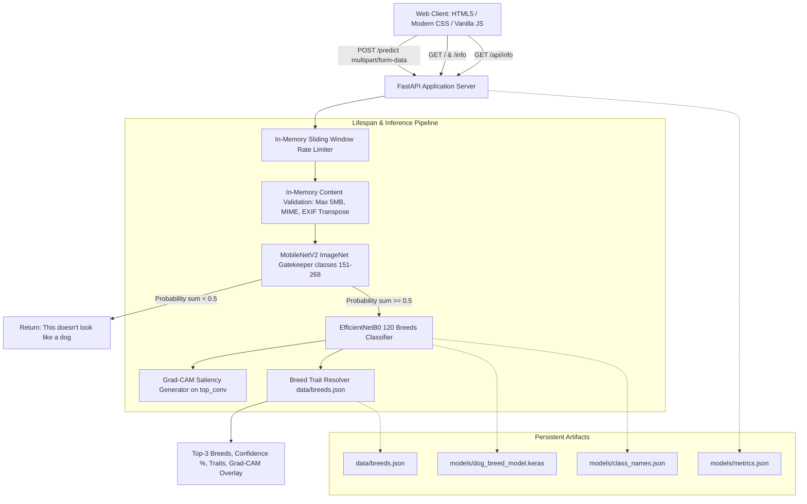

# 🐾 Dog Breed Detection & Interpretability System

An academic, production-grade web application for fine-grained canine breed recognition with Explainable AI (Grad-CAM), non-dog filtering, and comprehensive breed trait profiles across 120 breeds from the Stanford Dogs Dataset.

---

## 🌟 Key Features

1. **Fine-Grained Classification (120 Breeds)**:
   - Uses an **EfficientNetB0** transfer learning model with a custom classification head.
   - Evaluated on **8,580 unseen test images** from the official Stanford Dogs benchmark, achieving **84.15% Top-1 Accuracy** and **98.40% Top-5 Accuracy**.
   - Compares against baseline Multi-Layer Perceptron (**4.09%**) and Custom 4-block CNN (**10.89%**).

2. **MobileNetV2 Canine Gatekeeper**:
   - Pre-screens uploads before running breed classification using ImageNet-pretrained **MobileNetV2**.
   - Evaluates the sum of probabilities across canine classes (ImageNet indices 151–268).
   - Rejects non-dog images (cats, objects, landscapes) with: *"This doesn't look like a dog."*

3. **Explainable AI (Grad-CAM)**:
   - Optional toggle: *"Show what the model looked at"*.
   - Computes Gradient-Weighted Class Activation Mapping on feature layer `top_conv`.
   - Superimposes heatmaps over original photos to highlight canine anatomical saliency (ears, muzzle, coat patterns).

4. **Curated Breed Trait Profiles**:
   - Structured trait metadata across all 120 breeds in `data/breeds.json`.
   - Displays size, weight range, height range, temperament tags, energy level, grooming needs, child-friendliness, lifespan, origin, and descriptions.
   - Strictly verified: unverified or uncertain attributes are set to `null` (never hallucinated).

5. **Low-Confidence & Mixed-Breed Detection**:
   - If top-1 confidence is below 50%, flags: *"Not sure, this may be a mixed breed"* and reminds users the model is trained on purebred dogs.

6. **Robust Production Engineering**:
   - In-memory stream validation with Pillow (validates magic bytes, not just file extensions).
   - Strict 5 MB payload limit with HTTP 413 handling.
   - Sanitizes filenames and never writes user uploads to disk.
   - In-memory sliding window rate limiting.
   - Automatic EXIF orientation correction for smartphone photos.
   - Fallback **DEMO MODE** if model weights are missing.

---

## 🏗️ System Architecture



---

## 🚀 Quickstart & Setup Instructions

### 1. Prerequisites
- Python 3.10+ (Tested on Python 3.13.7)
- Virtual environment (`venv/`)

### 2. Environment Activation
```powershell
# Windows PowerShell:
.\venv\Scripts\Activate.ps1
```

### 3. Install Dependencies
```bash
pip install -r requirements.txt
```

### 4. Run the Application Locally
```bash
python -m uvicorn app.main:app --host 127.0.0.1 --port 8000
```
Then navigate to:
- **Classifier Home**: [http://127.0.0.1:8000/](http://127.0.0.1:8000/)
- **Model Benchmark Info**: [http://127.0.0.1:8000/info](http://127.0.0.1:8000/info)
- **Interactive API Docs (Swagger UI)**: [http://127.0.0.1:8000/docs](http://127.0.0.1:8000/docs)

---

## 🧪 Automated Testing Suite

Run the full pytest suite:
```bash
pytest -v
```

The test suite covers:
- `test_health_endpoint`: Checks server health and model readiness.
- `test_metrics_info_endpoint`: Validates dynamic non-hardcoded retrieval of `metrics.json`.
- `test_valid_dog_prediction_without_gradcam`: Tests `n02085620_2650.jpg` predicting Chihuahua at ~81.71%.
- `test_valid_dog_prediction_with_gradcam`: Validates Grad-CAM base64 data URI output.
- `test_non_dog_image_rejection`: Validates MobileNetV2 gatekeeper rejecting cat images.
- `test_oversized_file_rejection`: Validates 5 MB size limit (HTTP 413).
- `test_wrong_file_type_rejection`: Validates unsupported extensions (HTTP 400).
- `test_corrupted_image_rejection`: Validates corrupt byte streams (HTTP 400).
- `test_rate_limiter_behavior`: Validates sliding window blocking and test isolation resets.

---

## 📊 Evaluation & Benchmark Results

Evaluated on **8,580 unseen canine images** from the Stanford Dogs test split:

| Model Architecture | Paradigm | Top-1 Accuracy | Top-5 Accuracy | Test Loss |
| :--- | :--- | :---: | :---: | :---: |
| **ANN Baseline** | Flattened Pixel MLP | 4.09% | 17.03% | ~4.78 |
| **Custom CNN** | 4-Block Conv2D + BatchNorm | 10.89% | 32.60% | ~3.82 |
| **EfficientNetB0 (Ours)** | Transfer Learning + Fine-Tuning | **84.15%** | **98.40%** | **0.5264** |

---

## ⚠️ Limitations & Future Work

### Limitations
1. **Purebred Assumption**: The model is trained exclusively on purebred dogs from the Stanford Dogs dataset. Multi-breed mixes are classified against their dominant visual traits with a low-confidence warning.
2. **Wild Canine Handling**: Stanford Dogs includes wild canids (Dingo, Dhole, African Wild Dog). Traits for these species lack pet-specific ratings (such as grooming or good with children).
3. **Extreme Occlusion / Multi-Dog Images**: The model performs global average pooling over the entire image frame; bounding box localization (YOLO/Faster R-CNN) would be required to handle multiple dogs in a single picture.

### Future Work
1. **Multi-Dog Object Detection**: Pre-crop individual canines using an object detector prior to classification.
2. **Confidence Calibration**: Apply temperature scaling to further calibrate softmax probabilities for out-of-distribution mixed breeds.
3. **Breed Comparison Tool**: Allow side-by-side comparison of visually confusing breeds (e.g. Norfolk vs. Norwich Terrier).
4. **Offline Mobile PWA**: Export the model to TensorFlow Lite / ONNX Web for edge classification on mobile devices without server uploads.

---

## 🐕 Interactive 3D Mascot & Sensory FX

The frontend features a client-side, interactive companion: **Buddy the 3D Talking Dog**.

### Features
1. **Three.js 3D Mascot**:
   - Real-time 3D canine mascot with dynamic pointer/cursor head tracking, breathing idle, blinking eyelids, wagging tail, and animated hinged jaw during speech.
   - Five responsive behavior states: `idle`, `thinking`, `happy`, `talking`, and `confused`.
   - **Adaptive Breed Scaling & Tinting**: Dynamically adjusts size based on the predicted breed's size category (Toy $0.78\times$ to Giant $1.28\times$) and tints fur tone according to breed characteristics.
   - **Offline & Graceful Fallback**: Three.js r128 and GLTFLoader are vendored locally in `static/vendor/` with zero CDN dependence. If WebGL is unavailable, automatically degrades to an inline vector graphic.
2. **Talking Dog Engine (Web Speech & Web Audio API)**:
   - Synchronized speech narration generated strictly from verified non-null traits in `data/breeds.json` (never hallucinates).
   - Audio priming on button click ensures zero autoplay blocking.
   - Synthesizes dual-tone puppy barks using Web Audio oscillators.
   - Interactive UI controls: **Replay 🔄**, **Mute 🔇** (persisted in `localStorage`), and **Stop ⏹️**.
3. **Sensory Effects & Celebratory Confetti**:
   - High-confidence classifications ($\ge 70\%$) trigger a celebratory confetti and paw-print burst.
   - Optional looping background video or layered interactive canvas.
4. **Master Effects Toggle & Accessibility**:
   - Easily toggle all 3D, speech, audio, and visual effects via the **"Effects: On / Off"** button in the top navigation.
   - Deactivate all effects directly via URL: `http://127.0.0.1:8000/?fx=off`.
   - Strictly respects `prefers-reduced-motion: reduce`.

### Customization & Asset Swapping
- **Custom 3D Model**: Place a standard GLTF/GLB model at `static/assets/models/dog.glb`. If detected, Three.js loads the custom mesh; otherwise, it falls back to the built-in procedural stylized dog.
- **Custom Background Video**: Place a looping MP4 video at `static/assets/videos/bg.mp4`. If detected, it plays seamlessly behind a dark contrast overlay.

### Assets & Credits
- **Three.js (r128)**: Licensed under the [MIT License](https://github.com/mrdoob/three.js/blob/dev/LICENSE) &copy; 2010-2026 Three.js authors.
- **GLTFLoader**: Licensed under the [MIT License](https://github.com/mrdoob/three.js/blob/dev/LICENSE) &copy; 2010-2026 Three.js authors.
- **Speech & Sound**: Synthesized purely in-browser using W3C standard Web Speech and Web Audio APIs without external third-party service fees.

---

## 📜 Educational Disclaimer
*For educational purposes only. Not veterinary or official breed-certification advice.*

